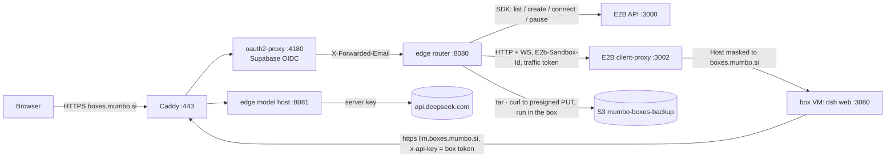

# mumbo boxes: design v1 (trial)

Each allowlisted user gets one persistent box: a Firecracker microVM on our self-hosted E2B runtime, running their own `dsh web`. An edge service in front of E2B routes each user to their box, holds every secret, pauses idle boxes and backs box data up to S3. This replaces the shared Fargate server. Trial measurements and scripts are in `trial/`.

## Requirements

| # | Requirement |
|---|---|
| R1 | One box per user. Nobody can reach another user's box, chats or files. |
| R2 | A box stays alive while it is used, including agent turns with the tab closed. An idle box is paused with its memory and resumes on the next visit. |
| R3 | Box data survives a box kill, an E2B host loss and an image upgrade. |
| R4 | No secret (DeepSeek key, OAuth secrets) enters a box. |
| R5 | Model use is attributed and limited per user. |
| R6 | Agents can fork the box or start small sandboxes. Phase 2, not this build. |
| R7 | Everything runs in our AWS account and reinstalls from this repo. |

## Architecture

Code: `edge/edge.mjs` (router and model host in one Node process), `edge/compose.yaml` (Caddy, oauth2-proxy, edge, all on loopback except Caddy), `edge/up.sh` (secrets from SSM into `.env`, then `docker compose up`), `edge.tf` (bucket, IAM, SSM settings, DNS, ports 80/443), `edge/template.mjs` (builds the `mumbo-box` template from a shipped ECR image). For the trial all of this runs on the E2B host.

## Flows

**Open my box.**
1. oauth2-proxy signs the user in with Supabase. Only oauth2-proxy reaches the router (loopback), so `X-Forwarded-Email` is trusted. The router lowercases it and checks `ALLOWED_EMAILS` (addresses or `@domains`); anyone else gets 403.
2. A per-email single flight finds the box by E2B metadata `user=<email>` in states running and paused, the oldest if several. E2B is the only ownership record. A failed lookup returns 503 and never creates a box.
3. No box: refuse with a capacity page if `MAX_RUNNING_BOXES` are running. Otherwise create from `mumbo-box` with:
   - `lifecycle {onTimeout: pause, autoResume: true}`;
   - `network {allowPublicTraffic: false, maskRequestHost: boxes.mumbo.si}`;
   - an E2B timeout of `IDLE_MINUTES + 15`.

   Then restore the user's backup inside the box, write `start.sh` and start `dsh web`. Measured: 8.3 s.
4. A paused box, or one unknown to this edge process, is connected (resumed, 0.5–2.3 s). If `dsh` does not answer, `start.sh` is re-run in place.
5. The router reads the launch token from `/root/dsh.log`. It proxies with `E2b-Sandbox-Id`, `E2b-Sandbox-Port: 3080` and the box's `e2b-traffic-access-token`, and drops the client's identity, auth and `e2b-*` headers.
   - A request with no `dsh-auth-*` cookie and no token gets a 302 to `/?token=…`.
   - A navigation answered 401 (a stale cookie from another account or an older box) gets the same 302.
   - `Secure` is added to every Set-Cookie.

   The cookie name is the same for every user on this host. Cookie values are checked by each box's own secret, so a cookie cannot cross users.

**Activity and pause (R2).** Activity is recorded on:
- every proxied request;
- every WebSocket frame from the browser;
- every model call made with the box's token, which covers agent turns with the tab closed.

Activity pushes E2B's timer out, at most once a minute. A sweep every minute:
- backs up boxes active in the last `BACKUP_MINUTES`;
- backs up, then pauses, boxes idle for `IDLE_MINUTES`.

E2B's own `onTimeout: pause` (15 minutes later) is the safety net if the edge is down.

**Model calls (R4, R5).**
- The box only holds `DEEPSEEK_API_KEY=<box token>` (`mbx.` + base64url{u, b} + HMAC). Both `DEEPSEEK_BASE_URL` and `DEEPSEEK_SEARCH_BASE_URL` point at `llm.boxes.mumbo.si`, a separate host, because dsh's model listing and web tools use the origin of the base URL.
- The model host accepts a token only when all of these hold:
  - the request comes from a box egress IP (`BOX_EGRESS_IPS`, the host's own address);
  - the HMAC is valid;
  - `b` is `u`'s current running box (adopted from E2B after an edge restart);
  - the path is `/anthropic/*`, `/models` or `/v1/tools/*`;
  - the user is within the daily request budget.
- It swaps in the server key and streams the response. One log line per call: user, box, path, status, latency.

**Backup (R3).**
- The router owns backups. It signs a 15-minute PUT URL for `users/<sha256(email)>/latest.tar.gz` and runs `tar … | curl -T -` inside the box. Excluded: `node_modules` and SQLite WAL files.
- Session logs tolerate a torn tail, and storage-json writes atomically, so a live tar restores cleanly.
- Bucket versioning keeps older backups for 30 days.
- Worst case on host loss: `BACKUP_MINUTES` of files and chats (10), plus all memory state.

**First-run welcome** (spec section 17a, step 5).
- While `/root/.dsh/welcomed` is absent, a person box's `start.sh` mounts `@deepseek-ai/dsh-hooks-claude-code` with one `UserPromptSubmit` hook. The hook creates the marker with noclobber. Only the prompt whose hook created it gets the welcome (`welcomeInstructions` in `edge.mjs`) as added context. Project boxes have no welcome. The role `AGENTS.md` cannot carry it, because dsh reads that file into every new session.
- The marker means the box has been welcomed, or had sessions before it could be. `start.sh` also creates it, with no welcome, when dsh's sessions root `/root/.dsh/sessions` holds any file: a restart, or a restore from a backup taken before the welcome existed. A chat opened but never sent to may count as a session. The marker is under `/root/.dsh`, so backups carry it.
- The bridge is mounted only on starts where the marker is absent: from a new box's first start until its first start after the welcome. Until then each prompt runs a no-op hook (about 8 ms) and logs `hook/invoked` and `hook/result`.
- Delivery is at most once. The marker exists before the model sees the welcome, so a failed first turn (model error, abort) loses it. This is accepted.
- dsh runs hooks through its shell service under the box's `sandbox-policy`, without approval. They run because `mumbo.overlay.yml` sets `danger-full-access`. Under `workspace-write` on a host without bubblewrap or Landlock, dsh refuses the hook and nobody is welcomed.
- Operators run a command in a person's box from `deploy/boxes/edge`, with the E2B variables from RUNBOOK "Rebuild the box template":
  `node --input-type=module -e 'import { Sandbox } from "e2b"; const [user, cmd] = process.argv.slice(1); for (const b of await Sandbox.list({ query: { metadata: { user } } }).nextItems()) console.log(b.sandboxId, (await (await Sandbox.connect(b.sandboxId)).commands.run(cmd)).stdout)' <email> '<command>'`.
  - To suppress the welcome, run `touch /root/.dsh/welcomed`; it applies from the next prompt.
  - To re-arm it, run `rm /root/.dsh/welcomed`; it works only in a box without sessions, from its next dsh start. A box with sessions is marked again at its next start, so showing the welcome again needs a new box: delete the box and its backups, then sign in.

**Upgrade.** A new template reaches a user when their box is next created. A forced upgrade (backup, then kill and recreate) is a manual operation in v1, and only right after a successful backup.

## Failure handling

| Failure | Behavior |
|---|---|
| E2B API error on lookup or create | 503 page that retries every 5 s. No duplicate box is created. |
| dsh not up 90 s after a new start | The new box is killed (it holds only the restored backup) and the user gets 503. |
| dsh dead after a resume | `start.sh` restarts it in place; data stays. |
| Edge restart | Launch tokens are re-read from boxes. Box tokens are re-validated against E2B. In-memory budgets reset. |
| Backup or pause fails | Logged; the next sweep retries. E2B's own timeout pauses the box regardless. |
| DeepSeek 5xx | Passed through; dsh's `llm-retry` retries. |
| Box lost | The next visit recreates the box from the latest backup. |
| E2B host lost | The ASG replaces the instance, but E2B data and the edge install are gone. Re-run `edge/up.sh` and rebuild the template. Users get new boxes restored from S3. |

## Known limits of v1

- Single E2B host: a single point of failure for every box. Its memory pool (8 GiB) holds about 3 running 2 GiB boxes, hence `MAX_RUNNING_BOXES=3`.
- E2B team limits (720 h, 200 sandboxes) were raised by hand in E2B's Postgres. A fresh host needs the same change.
- Budgets count requests, not tokens, and live in memory.
- Box egress is open internet (agents install packages). Boxes cannot reach private ranges.
- Not built: fork and child sandboxes (R6), multi-node, cutting app.mumbo.si over, the desktop app.

## Bring-up

1. `terraform apply` in `deploy/boxes`. This creates the bucket, IAM, SSM settings, DNS for `boxes.mumbo.si` and `llm.boxes.mumbo.si`, and ports 80/443.
2. In Supabase, create an OAuth client with redirect `https://boxes.mumbo.si/oauth2/callback`, and store it as `/mumbo/boxes/oauth-client-id` and `/mumbo/boxes/oauth-client-secret` (SecureString).
3. Build the template: `node deploy/boxes/edge/template.mjs <ecr image>`.
4. On the host, as root: fetch `deploy/boxes/edge/` at the deployed commit into `/opt/mumbo-edge` and run `./up.sh`.
