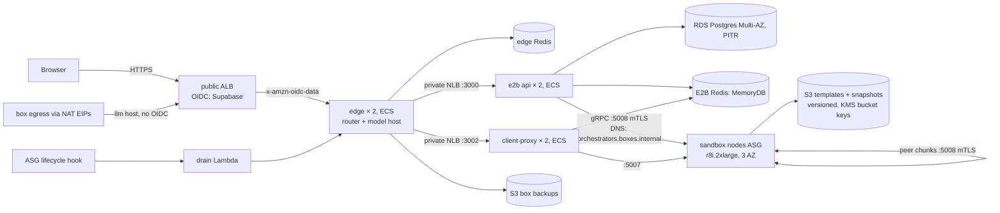

# mumbo boxes: production plan

This is the production platform for per-user boxes: E2B across many EC2 machines in our AWS account, with no single host. The trial in DESIGN.md (one E2B Embed host) keeps serving `boxes.mumbo.si` until stage 7 cuts over. Every stage ships with tests and is verified live before the next starts.

## Decisions (founder, 2026-11-08)

- Plain EC2 and a small E2B fork, not EKS. The fork adds DNS service discovery (about 20 lines), offered upstream.
- Self-hosted from the start; data stays in our AWS account; operated by a team of agents, so every operation has a runbook and an alarm.
- Boxes are paused with their memory when idle. Agents get box forks and small sandboxes (stage 8).

## Architecture

## Stages

| # | Stage | Done when |
|---|---|---|
| 1 | **E2B fork:** `dns` discovery provider plus image build to our ECR | Unit test; api lists two node IPs from one DNS name |
| 2 | **Network and data:** VPC 10.20/16 in 3 AZs with NAT per AZ; RDS Postgres Multi-AZ with PITR; MemoryDB for E2B; ElastiCache for the edge; S3 templates bucket (versioned, Bucket Keys); KMS | `terraform plan` clean; RDS restore drill documented |
| 3 | **mTLS:** private CA and certificates for api, client-proxy and orchestrator (Secrets Manager), `required` on gRPC and peers. Code: `prod/tls.tf`, `prod/mtls/`; `prod/mtls/check.sh <fork>` runs the issued certificates through E2B's own mtls package | Handshake refused without a client certificate (check.sh, passing) |
| 4 | **Sandbox nodes:** AMI (Ubuntu 24.04, hugepages and nbds at boot, Firecracker and kernel versions retained); systemd orchestrator that drains, not kills, on SIGTERM; Route53 private registration; ASG with lifecycle hook and drain Lambda | Two nodes registered; box created, paused on node A, resumed on node B |
| 5 | **Control plane:** api and client-proxy × 2 on ECS behind an internal NLB; migrations as one-shot ECS tasks; `Recreate`-style deploys | E2B SDK smoke test passes through the NLB |
| 6 | **Edge on ECS:** public ALB with OIDC (Supabase), llm host rule, edge × 2 with ElastiCache, `BOX_EGRESS_IPS` = NAT EIPs; template build on a node | Browser test: sign in, chat with bash, model calls proxied |
| 7 | **Operations:** CloudWatch alarms (orphan kills, backup age, hugepage pool, node not ready, Redis failover, 5xx); runbooks; drills (hard-kill a node mid-upload, orchestrator N→N+1, RDS restore); cut `boxes.mumbo.si` over, then `app.mumbo.si`, and retire Fargate and the trial | All drills pass; alarms fire in tests |
| 8 | **Agent sandboxes:** a fork/child-sandbox subagent provider in the harness; per-user sandbox caps | Agent fans out 10 sandboxes |

## Review findings carried into the build (design review, 2026-11-08)

- **B1. Redis loss kills running VMs.** E2B treats Redis as the source of truth. Use MemoryDB (durable), not ElastiCache, for E2B, and alarm on orphan kills.
- **B2. Any orchestrator SIGTERM kills every box on that node.** Patch the launcher to drain. Only blue/green node upgrades. Never in-place restarts.
- **B3. Unresumable snapshots.** The edge recreates the box from backup. Done (edge `a2af52b`).
- **M2. mTLS** is required on gRPC and peers. The api's HTTP port stays plaintext behind the private NLB (the edge calls it with the E2B API key). Restrict :5007 to client-proxy. Certificates last a year; an apply in the last 60 days re-issues them, and E2B re-reads them every minute.
- **M3. Backups** run in parallel without the user lock. Done.
- **M4.** Versioned templates bucket and an RDS PITR drill.
- **M5.** Plan 12–16 boxes per node until measured. Keep one warm spare node. Capacity comes from E2B errors.
- Cut for v1: ClickHouse (empty DSN means noop), volumes (`VOLUME_TOKEN_ENABLED=false`), the dashboard, Loki/vector (CloudWatch agent instead), a dedicated build ASG.

## Cost (estimate, us-east-1, on-demand)

About $2–2.5k a month at the minimum footprint: 3 sandbox nodes, control plane, RDS Multi-AZ, MemoryDB, ElastiCache, NAT in 3 AZs, ALB/NLB, logs. Each further r8i.2xlarge node is about $460 a month for 12–16 running boxes. Paused boxes cost only S3.
